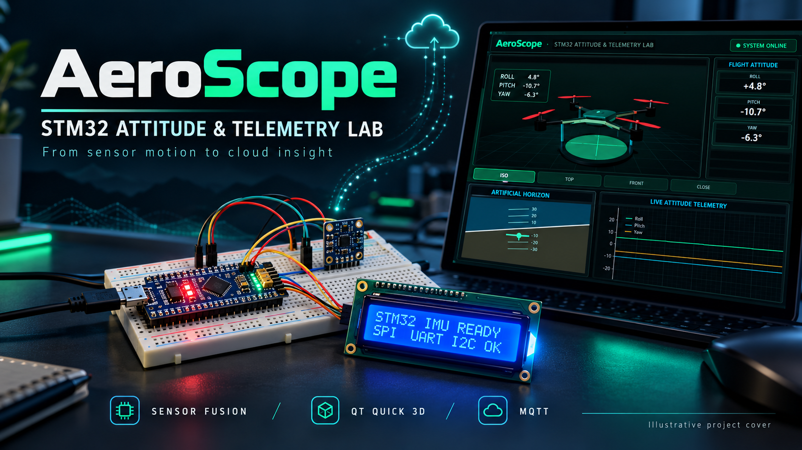
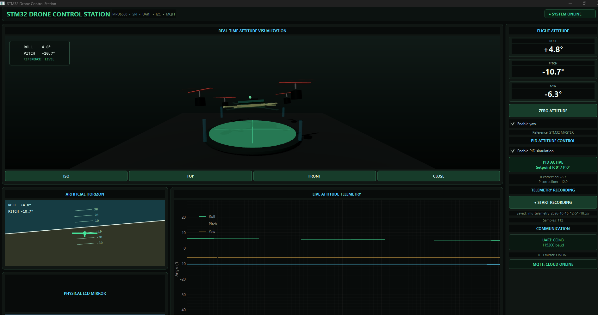
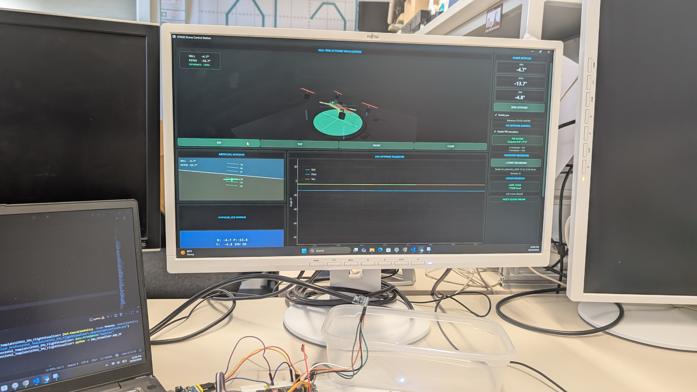
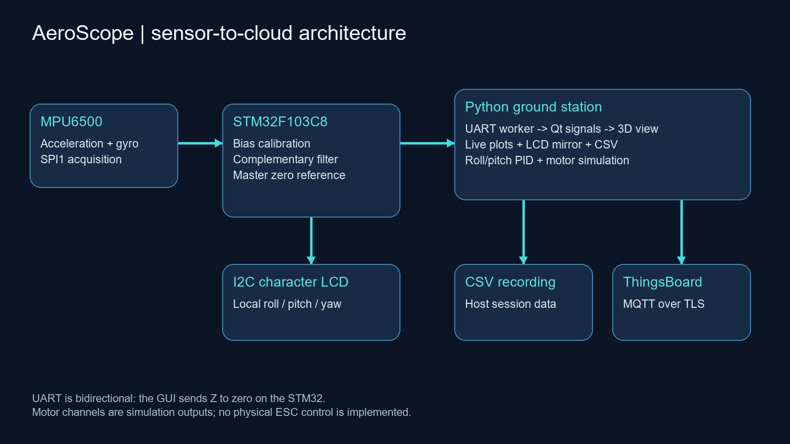
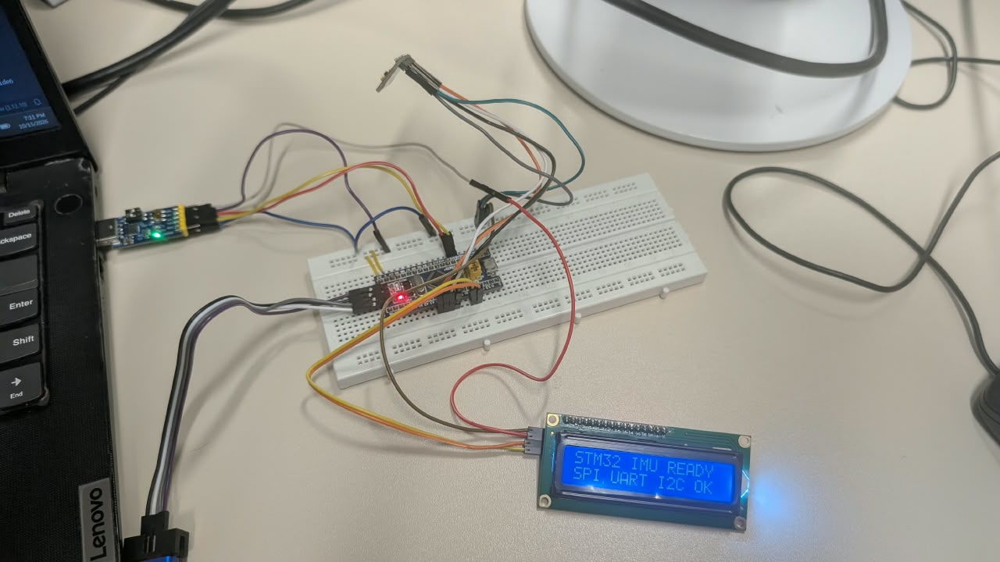
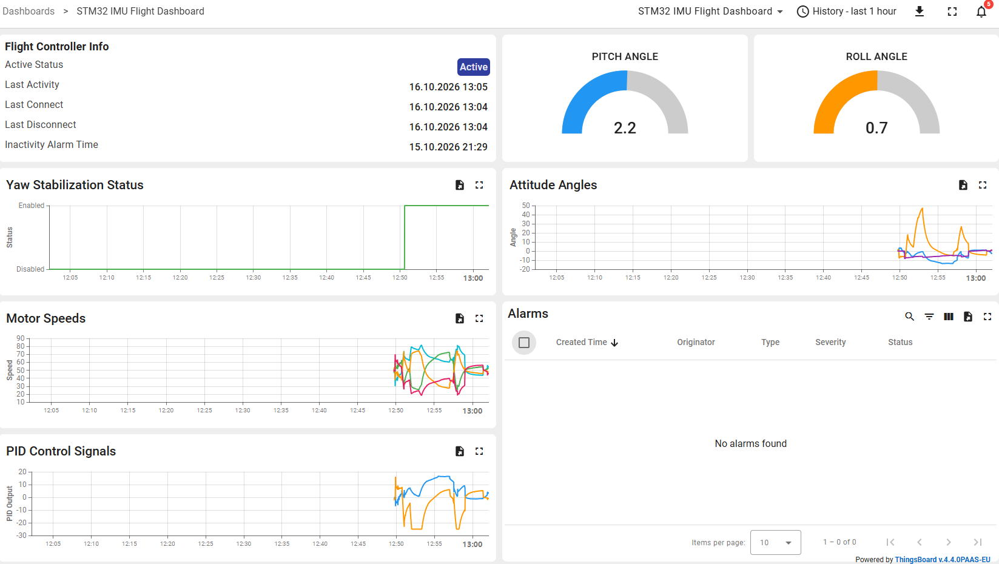

# AeroScope — STM32 Attitude & Telemetry Lab



**From sensor motion to cloud insight.** A personal embedded systems project connecting an MPU6500, STM32 firmware, a local LCD, a Python 3D ground station and optional ThingsBoard telemetry.

[Quick start](#quick-start) · [Hardware](docs/hardware-wiring.md) · [Firmware](docs/firmware-and-sensor-fusion.md) · [Desktop & cloud](docs/desktop-and-cloud.md) · [Results](docs/testing-and-results.md) · [Demo videos](demo/README.md)

## The problem I worked on

Raw accelerometer and gyroscope readings are difficult to interpret while moving a device. I built a complete bench workflow that converts sensor readings into roll, pitch and relative yaw, displays the same orientation locally and on a desktop, records sessions, and forwards telemetry to a cloud dashboard.

I personally developed and integrated the hardware setup, embedded firmware, desktop application and GUI. The project combines sensor interfacing, attitude estimation, serial communications, visualisation and IoT telemetry in one demonstrable system.

## See it working


*Supplied application screenshot: 3D attitude, live plots, LCD mirror and simulated motor channels.*


*Real bench demonstration. The physical aircraft in the photographs is demonstration context; this repository does not establish flight control or autonomous flight.*

| Hardware demonstration | Desktop and cloud demonstration |
|---|---|
| [Watch/download the hardware clip](demo/hardware-attitude-demo.mp4) | [Watch/download the GUI and ThingsBoard clip](demo/ground-station-and-cloud.mp4) |

## System architecture



The STM32 computes attitude and applies zero offsets. Its UART output feeds the Python application; the desktop also sends `Z` to request a new zero reference. The LCD is updated directly by the STM32. PID calculations and motor mixing are **host-side simulations**, with no ESC/PWM output in the supplied firmware.

## What the project includes

- MPU6500 accelerometer/gyroscope acquisition over SPI and stationary gyro bias calibration.
- Complementary filtering for roll/pitch and gyro integration for relative yaw.
- I2C LCD output and a readable UART telemetry protocol at 115200 baud.
- PySide6 / Qt Quick 3D desktop visualisation, artificial horizon and live plots.
- Roll/pitch PID calculation, four-channel motor mixing and visual feedback.
- CSV session logging and optional MQTT over TLS to ThingsBoard.
- STM32CubeMX configuration, STM32CubeIDE project, source code and supplied demonstration evidence.

## Hardware

| Component | Role |
|---|---|
| STM32F103C8Tx development board | Acquisition, filtering, zero reference, LCD and UART |
| MPU6500 module | Three-axis acceleration and angular rate |
| Character LCD with I2C backpack | Local attitude display; configured address `0x27` |
| USB-to-UART interface | PC telemetry and zero command |
| ST-Link / SWD programmer | Firmware programming and debugging |
| Breadboard, jumper wires and suitable power | Bench integration |
| Windows PC | Supplied Python GUI and MQTT gateway |



See the [pin table and electrical checks](docs/hardware-wiring.md) before wiring. This is a breadboard-based integration project; custom PCB manufacturing files are not included.

## Quick start

### 1. Build and flash the STM32

Import `firmware/` into STM32CubeIDE as an existing project. Review the `.ioc` configuration, build the project and flash through SWD. Keep the IMU stationary during the startup gyro calibration. See [firmware documentation](docs/firmware-and-sensor-fusion.md) for the processing sequence and troubleshooting.

### 2. Run the desktop application

From the repository root in Windows PowerShell, with Python 3.11 or newer installed:

```powershell
py -m venv .venv
.\.venv\Scripts\Activate.ps1
python -m pip install -r host/requirements.txt
$env:AEROSCOPE_SERIAL_PORT = "COM3" # replace with your adapter's port
$env:PYTHONPATH = "$PWD\host\src"
python -m imu_visualizer.app_3d
```

Alternatively, after installing dependencies, run `tools/Start-GroundStation.ps1 -Port COM3` from an activated environment. The current launcher is `app_3d`; older modules are retained as development history.

### 3. Observe, zero and record

Connect the UART interface and keep the assembly stationary on startup. The application attempts to open the configured serial port when it starts. Move the IMU to see the 3D view and plots change. Use the GUI zero control to send `Z` to the STM32. Use the logging controls to record CSV telemetry. Compare the LCD with its desktop mirror. After a lost serial connection, restore the connection and restart the application.

### 4. Enable cloud telemetry (optional)

Local visualisation does not require a cloud account. For ThingsBoard, create a device and set its access token in the current shell **before launching**:

```powershell
$env:THINGSBOARD_ACCESS_TOKEN = "YOUR_DEVICE_TOKEN"
$env:MQTT_ENABLED = "1"
# Default host: mqtt.eu.thingsboard.cloud; override for your own tenant:
$env:MQTT_HOST = "mqtt.eu.thingsboard.cloud"
python -m imu_visualizer.app_3d
```

The client uses TLS on port 8883 and publishes to `v1/devices/me/telemetry`. Never commit a real device token. See [desktop and cloud setup](docs/desktop-and-cloud.md).

## Recorded results


This chart uses the supplied 112-row recording, covering approximately 61.56 seconds. Its median logging interval is approximately 0.555 seconds. That is a **host CSV observation**, not a measurement of the IMU acquisition rate or proof of estimation accuracy. [Open the CSV](data/sample/recorded-telemetry.csv).



The supplied photos, screen captures and videos document the bench workflow. The [validation page](docs/testing-and-results.md) separates these observations from checks performed while preparing this repository.

## Engineering concepts demonstrated

Embedded C and STM32 HAL; SPI, I2C, UART and SWD; sensor calibration and complementary filtering; Python threading and Qt signals; Qt Quick 3D and GUI design; PID and motor-mixing simulation; MQTT/TLS; CSV logging; hardware/software integration and debugging.

## Scope and technical boundaries

- Relative yaw can drift because no magnetometer or external heading reference is used.
- The sensor ID is read but is not enforced by a validation check.
- A 20 ms loop delay does not establish a fixed 50 Hz acquisition rate; communication and LCD updates add work.
- The desktop motor channels are simulated values, not physical motor commands.
- The supplied evidence is a bench demonstration, not a flight, accuracy or safety certification.

## Repository guide

| Path | Contents |
|---|---|
| `firmware/` | STM32CubeIDE/CubeMX project, application and vendor drivers |
| `host/` | Python application, QML, requirements and tests |
| `docs/` | Wiring, processing, software, results and media provenance |
| `docs/images/` | Real project photos/screenshots, diagrams and illustrative cover |
| `data/sample/` | Supplied recorded telemetry |
| `demo/` | Selected compressed demonstration videos |
| `tools/` | Convenience launcher |

Additional references: [Troubleshooting](docs/troubleshooting.md), [photo gallery](docs/gallery.md), [media provenance](docs/media-and-provenance.md), [licensing](THIRD_PARTY_NOTICES.md).

The cover is an illustrative promotional graphic. Photographs and GUI screenshots elsewhere are supplied project evidence. Documentation organisation was informed by established projects such as [Crazyflie](https://github.com/bitcraze/crazyflie-firmware), [PX4](https://github.com/PX4/PX4-Autopilot) and [QGroundControl](https://github.com/mavlink/qgroundcontrol); no equivalence in capability is implied.
