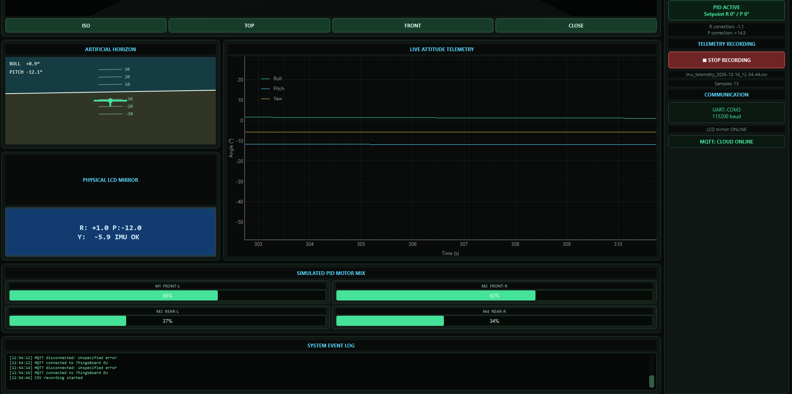
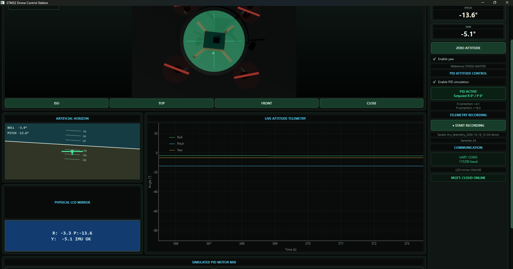
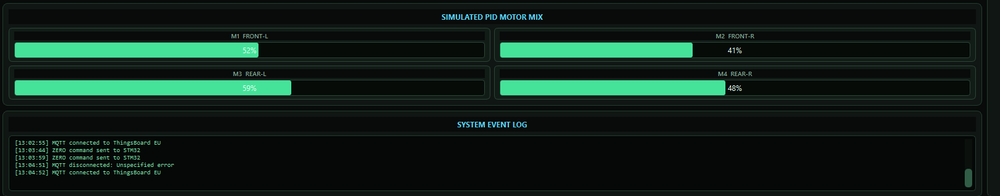

# Desktop application and cloud telemetry

## Software map

| Module | Responsibility |
|---|---|
| `app_3d.py` | Current GUI entry point, serial worker, controls, timers and CSV recording |
| `parser.py`, `models.py` | Attitude-line parsing and data representation |
| `visualizer3d.py`, `drone_view.qml` | Qt Quick 3D scene integration and visual model |
| `pid_controller.py` | Host-side PID calculation |
| `motor_mixer.py` | Four simulated motor percentages |
| `mqtt_client.py`, `config_mqtt.py` | MQTT connection, TLS and telemetry configuration |
| `config.py` | Serial port and common settings |

The serial worker runs in a QThread and passes updates through Qt signals. It owns the port and queues outgoing commands. This keeps serial reads out of the GUI thread. On connection failure, the worker stops; automatic reconnect is not implemented.

The 3D view offers ISO, TOP, FRONT and CLOSE cameras. The interface includes an artificial horizon, roll/pitch/yaw plots, LCD mirror, zero control, simulated motor bars and CSV recording. The yaw visualisation toggle is off by default. Older `main.py` and legacy visualiser modules remain in the source but are not the documented launcher.




## PID and motor mixing

The current GUI uses roll/pitch setpoints of zero, gains Kp=1.2, Ki=0, Kd=0.08 and a default base value of 50 percent. The PID class supports an integral term but does not implement anti-windup.

```text
M1 (front left)  = base - roll + pitch
M2 (front right) = base + roll + pitch
M3 (rear left)   = base - roll - pitch
M4 (rear right)  = base + roll - pitch
```

Each output is clamped to 0..100. These values drive the desktop presentation and logs. No physical motor-control link is implemented.



## Timing and logging

GUI/PID timer: 50 ms; graph timer: 100 ms; configured MQTT interval: 200 ms. These are requested event-loop intervals, not guaranteed throughput. CSV fields are `time_s`, `roll_deg`, `pitch_deg`, `yaw_deg`, `roll_pid`, `pitch_pid`, four `motor_m*` columns and `mqtt_connected`.

## ThingsBoard

Create a ThingsBoard device, obtain its token, and set `THINGSBOARD_ACCESS_TOKEN` in the launching shell. Set `MQTT_ENABLED=1` to enable publishing. `MQTT_HOST` defaults to `mqtt.eu.thingsboard.cloud`; choose the endpoint for your tenant. The code uses TLS with certificate verification on port 8883, device token as username, QoS 0 and topic `v1/devices/me/telemetry`. Payloads contain a timestamp and values. The client uses a fixed client ID, so concurrent copies may conflict; use one instance per configuration.

The original source contained an embedded device credential. The publication copy reads environment variables instead; the original folder was not modified. Rotate that credential if it has been shared publicly. No cloud account was contacted during repository preparation. `.env` files are not automatically loaded by this application.

Create dashboard widgets using the telemetry keys that appear on your ThingsBoard device. Existing screenshots document a previous session; they are not an exported dashboard configuration.
