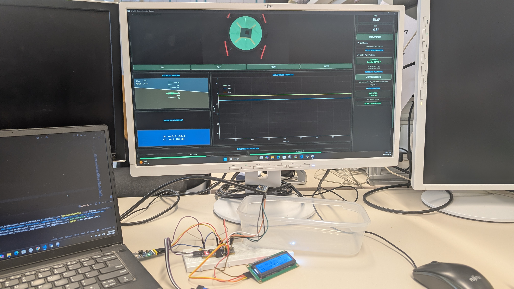
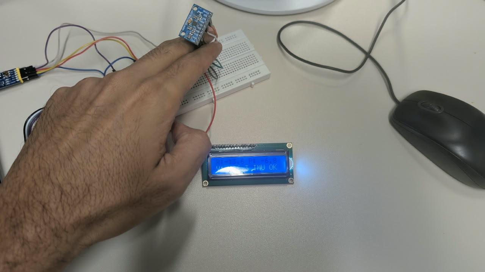
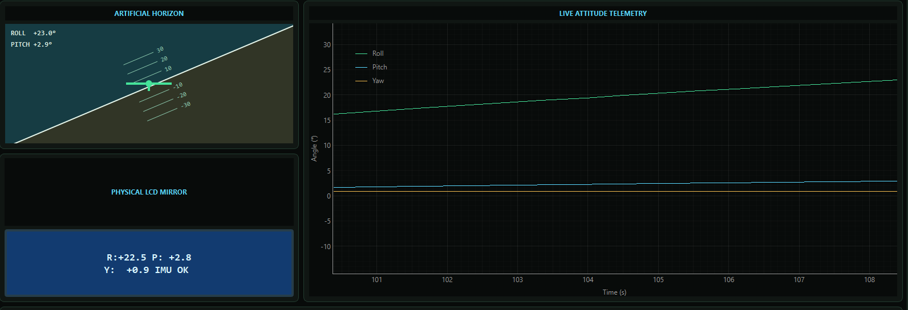

# Additional project evidence

## Sensor movement and bench setup

## Artificial horizon and attitude plot

## Camera and simulated motor views

These are supplied, unmodified photos and screenshots. Labels such as “flight controller”, “motor speeds” and “yaw stabilisation” in the original GUI/dashboard are preserved in the evidence; in this repository they refer to the demonstrated bench interface and simulation, not proof of physical flight control or absolute heading stabilisation.
