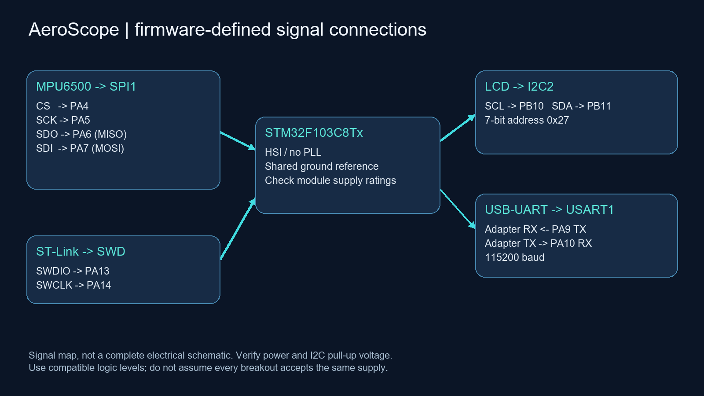
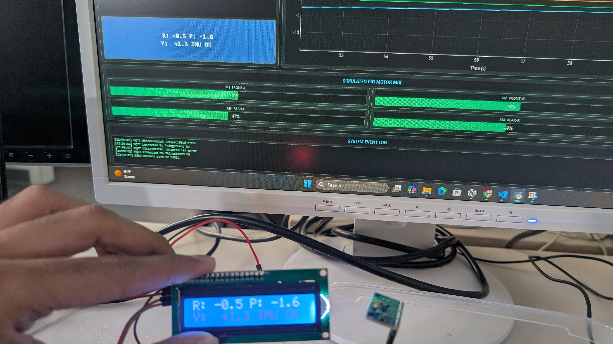

# Hardware and wiring

The pin mapping below is taken from the firmware and CubeMX configuration. The photos show the bench assembly; they are not an electrical schematic or a substitute for checking the exact breakout-board specifications.

| STM32 pin/interface | Connection | Purpose |
|---|---|---|
| PA4 | MPU6500 CS | Software chip select |
| PA5 / SPI1 SCK | MPU6500 SCLK | Clock |
| PA6 / SPI1 MISO | MPU6500 SDO | Sensor to MCU |
| PA7 / SPI1 MOSI | MPU6500 SDI | MCU to sensor |
| PB10 / I2C2 SCL | LCD backpack SCL | Display clock |
| PB11 / I2C2 SDA | LCD backpack SDA | Display data |
| PA9 / USART1 TX | USB-UART RX | Telemetry to PC |
| PA10 / USART1 RX | USB-UART TX | Zero command from PC |
| PA13 / SWDIO | Programmer SWDIO | Debug/programming |
| PA14 / SWCLK | Programmer SWCLK | Debug/programming |
| GND | Common reference | Connect module/interface grounds |

Use compatible 3.3 V logic for the MCU/sensor/UART interfaces. Exact module power circuitry is not established by the supplied files. Verify the MPU6500 breakout's allowed supply voltage, LCD backpack supply and I2C pull-up voltage before connecting. If the backpack pulls SDA/SCL to a voltage incompatible with the chosen MCU pins/configuration, use a suitable level shifter. Do not infer power compatibility from a connector label alone. Avoid conflicting power sources from the programmer, USB and external supply.

The LCD code uses 7-bit address `0x27` (shifted left once for HAL calls). A different backpack may require another address. USART1 is 115200 baud. SPI is configured mode 0, prescaler 2; the supplied configuration uses HSI without PLL rather than a presumed 72 MHz system clock. I2C2 is configured for 100 kHz.

## Bring-up sequence

1. Check power, common ground, pin assignment and signal levels.
2. Connect SWD, import/build/flash the firmware.
3. Keep the IMU still during startup bias calibration.
4. Check the LCD, then inspect UART output at 115200 baud.
5. Close any serial terminal before connecting the Python GUI.
6. Rotate one axis at a time and check signs, zeroing and display agreement.

