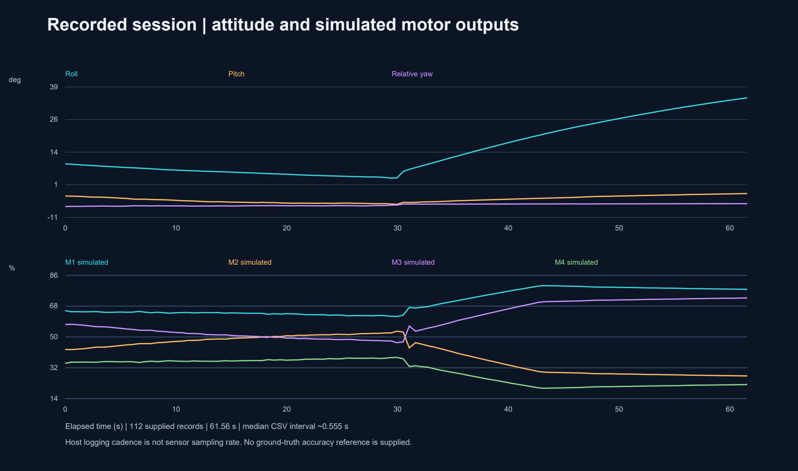

# Testing and observed results

## Supplied evidence

The selected photos and clips show the assembled bench hardware, LCD output, desktop visualisation and ThingsBoard dashboard. The included CSV is the supplied `imu_telemetry_2026-10-16_12-51-18.csv`, renamed for portability. It has 112 records over approximately 61.56 seconds, with a median interval of approximately 0.555 seconds between recorded rows.



These records contain measured/estimated orientation and simulated PID/motor values. There is no independent ground-truth orientation trace, so an accuracy or drift specification cannot be derived. CSV frequency does not establish firmware acquisition frequency.

## Checks during repository preparation

- Existing parser tests: **2 passed** using pytest on the publication copy.
- Supplied manual scripts executed: PID example printed -20.0; mixer example printed M1=65%, M2=45%, M3=55%, M4=35%. These are illustrative calculations, not hardware validation.
- Python sources were checked for syntax without launching the GUI.
- The missing `paho-mqtt` dependency was added to requirements; MQTT configuration now uses environment variables.
- Selected media was reviewed, and the supplied device-token value was checked against publication text files.
- No fresh STM32 compilation/flash, electrical measurements, live GUI/hardware run or live cloud test was performed.

Re-run parser checks from the root after installing requirements:

```powershell
$env:PYTHONPATH = "$PWD\host\src"
python -m pytest host/tests/test_parser.py -q
```

The other supplied test scripts include manual demonstrations that print values; they are not equivalent to automated assertion coverage. The GitHub workflow intentionally runs only the parser tests.

## Reproduction checklist

1. Keep the sensor stationary at boot; check LCD and UART values.
2. Rotate one axis at a time and compare desktop/LCD direction and reference.
3. Send zero and verify both displays update consistently.
4. Log a CSV and compare its values against the visible plots.
5. If cloud is enabled, check device telemetry timestamps and connection status.
6. Disconnect the UART deliberately, observe status, then restore the connection and restart the application.

Record tool versions, wiring, sensor mounting and observations when repeating these checks. They are suggested reproduction steps, not claims of newly executed hardware tests.
